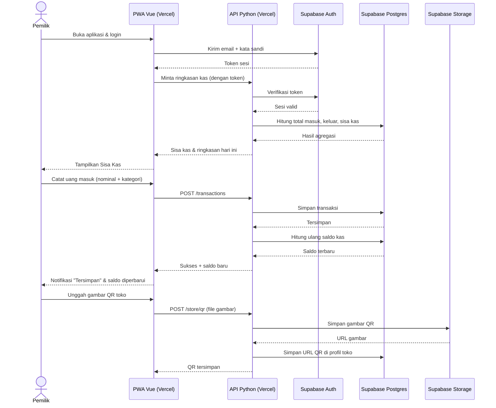
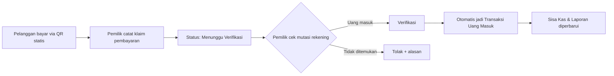
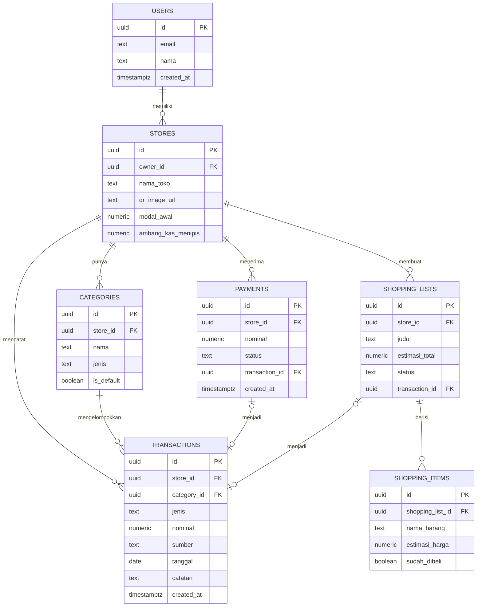

# PRD — Project Requirements Document

## 1. Overview

**Masalah yang diselesaikan**
Pemilik restoran kecil sering mencatat pemasukan dan pengeluaran secara manual di buku atau mengandalkan ingatan. Akibatnya, pemilik tidak tahu pasti sisa kas hari ini, berapa uang yang sudah terpakai untuk bahan dan operasional, serta berapa keuntungan yang benar-benar didapat. Pencatatan yang ribet membuat pemilik malas mencatat, sehingga catatan akhir bulan selalu berantakan.

**Tujuan utama aplikasi**
Membuat aplikasi kas khusus **satu restoran** yang sangat cepat dipakai — cukup beberapa ketukan untuk mencatat transaksi — dan langsung menampilkan sisa kas secara akurat. Aplikasi dipakai sehari-hari di ponsel (PWA, mobile responsive, bahasa Indonesia), sehingga pemilik bisa mencatat tiap kali ada penjualan atau belanja.

**Siapa penggunanya**
Pemilik restoran makanan yang mengelola keuangannya sendiri, bukan tim akuntan. Semua istilah dibuat sederhana dan tidak memakai bahasa teknis.

**Nilai pembeda**
Kecepatan mencatat (*first win*: transaksi pertama bisa dicatat dalam hitungan detik) dan alasan untuk kembali setiap hari: setiap ada jualan, langsung dicatat.

**Ruang lingkup**
Satu toko dalam satu akun. Tidak ada fitur multi-cabang, tidak ada akuntansi rumit. Fokus: catat uang masuk/keluar, lihat sisa kas, laporan + prediksi laba, terima bayar lewat QR statis dengan verifikasi manual, dan catatan belanja operasional.

---

## 2. Requirements

**Kebutuhan fungsional utama**
1. Pengguna harus bisa mencatat uang masuk dan uang keluar dalam maksimal 3–4 ketukan.
2. Setiap transaksi wajib punya jenis (masuk/keluar), nominal, kategori, dan tanggal.
3. Sisa kas harus selalu diperbarui otomatis setelah transaksi disimpan.
4. Pengguna bisa melihat laporan harian dan rekap per kategori.
5. Pengguna bisa mencari, memfilter, dan memperbaiki transaksi yang salah input.
6. Aplikasi menampilkan QR pembayaran statis milik toko dan menerima klaim pembayaran yang harus diverifikasi manual.
7. Pembayaran yang sudah diverifikasi otomatis menjadi catatan uang masuk.
8. Pengguna bisa membuat daftar belanja, memperkirakan biaya, dan mengubahnya menjadi catatan pengeluaran.
9. Data toko hanya bisa diakses pemilik melalui akun (daftar, masuk, keluar, lupa kata sandi).

**Kebutuhan non-fungsional**
- **Mobile first & PWA**: bisa dipasang di layar utama ponsel, tetap nyaman dipakai di jaringan lambat, dan tampilan tidak pecah di layar kecil.
- **Bahasa**: seluruh antarmuka berbahasa Indonesia dengan istilah sehari-hari ("Uang Masuk", "Uang Keluar", "Sisa Kas").
- **Kecepatan**: halaman catat transaksi terbuka < 2 detik pada jaringan 4G.
- **Keakuratan**: perhitungan sisa kas tidak boleh selisih; setiap perubahan transaksi langsung memperbarui saldo.
- **Keamanan**: data terpisah per akun/toko; QR dan data keuangan hanya bisa diakses pemilik yang login.
- **Satu toko per akun**: sesuai kebutuhan pemilik restoran tunggal.
- **Tanpa biaya tambahan berat**: memanfaatkan layanan gratis/murah (Supabase + Vercel).

---

## 3. Core Features

Fitur di bawah ini mengikuti kerangka roadmap yang sudah disetujui, disusun per fase.

### Fase 1 — Fondasi Pencatatan (prioritas tinggi)
- **Catat Transaksi**
  - *Catat Uang Masuk* — Masukkan penjualan atau uang yang diterima hari ini.
  - *Catat Uang Keluar* — Catat belanja bahan, operasional, dan transportasi yang keluar.
  - *Pilih Kategori Cepat* — Pilih kategori yang sudah tersedia agar tidak perlu mengetik panjang.
  - *Konfirmasi & Simpan* — Periksa nominal lalu simpan; catatan langsung tersimpan tanpa ribet.
- **Sisa Kas**
  - *Saldo Kas Sekarang* — Angka sisa kas yang selalu diperbarui setelah ada catatan baru.
  - *Rincian Modal & Operasional* — Pisahkan uang modal dengan uang yang sudah terpakai untuk operasional.
  - *Peringatan Kas Menipis* — Dapatkan pemberitahuan saat kas mulai menipis (ambang batas bisa diatur di Pengaturan Toko).

### Fase 2 — Riwayat & Laporan (prioritas tinggi/menengah)
- **Riwayat Transaksi**
  - *Daftar Semua Transaksi* — Lihat seluruh catatan dari yang terbaru sampai terlama.
  - *Cari & Filter* — Temukan catatan tertentu berdasarkan tanggal, jenis, atau kategori.
  - *Detail & Perbaiki* — Buka satu catatan untuk melihat rincian atau memperbaiki salah input.
- **Laporan & Prediksi Laba**
  - *Laporan Harian* — Ringkasan pemasukan, pengeluaran, dan sisa kas tiap hari.
  - *Rekap per Kategori* — Lihat kategori mana yang paling banyak menghabiskan uang.
  - *Prediksi Laba* — Perkiraan keuntungan berdasarkan modal dan pola penjualan beberapa hari terakhir.
  - *Unduh & Bagikan* — Simpan atau bagikan laporan dalam bentuk file (PDF/gambar) lewat WhatsApp atau aplikasi lain.

### Fase 3 — Pembayaran & Belanja (prioritas menengah)
- **Pembayaran QRIS**
  - *Tampilkan QR Toko* — Tunjukkan QR pembayaran statis ke pelanggan saat mau bayar.
  - *Daftar Pembayaran Masuk* — Pelanggan yang mengaku sudah bayar akan muncul menunggu diperiksa.
  - *Verifikasi Manual* — Tandai pembayaran sudah benar masuk setelah dicek di rekening.
  - *Masuk Otomatis Jadi Pemasukan* — Pembayaran yang sudah diverifikasi langsung tercatat sebagai uang masuk.
- **Catatan Belanja**
  - *Daftar Belanja* — Tulis kebutuhan belanja bahan dan operasional yang mau dibeli.
  - *Estimasi Biaya* — Perkirakan total uang yang perlu disiapkan untuk belanja.
  - *Tandai Sudah Dibeli* — Centang barang yang sudah dibeli agar daftarnya rapi.
  - *Jadikan Catatan Pengeluaran* — Ubah belanja yang sudah dibeli menjadi catatan uang keluar.

### Fase 4 — Pengaturan & Akun (prioritas menengah)
- **Pengaturan Toko**
  - *Profil Toko* — Isi nama dan informasi dasar resto yang dipakai di aplikasi.
  - *Unggah QR Pembayaran* — Pasang gambar QR statis yang akan ditampilkan ke pelanggan.
  - *Atur Kategori & Modal Awal* — Sesuaikan kategori catatan dan tentukan modal awal resto.
- **Masuk & Akun**
  - *Daftar Akun* — Buat akun baru dengan email dan kata sandi.
  - *Masuk & Keluar* — Buka aplikasi dengan akun sendiri dan keluar dengan aman.
  - *Lupa Kata Sandi* — Pulihkan akses akun saat lupa kata sandi.

---

## 4. User Flow

**A. Pertama kali membuka aplikasi (onboarding singkat)**
1. Pengguna membuka aplikasi PWA di ponsel, melihat penjelasan singkat 3 layar.
2. Pengguna membuat akun (email + kata sandi).
3. Mengisi profil toko: nama resto, modal awal, dan ambang batas "kas menipis".
4. Langsung diarahkan ke tombol besar **"Catat Transaksi"** — inilah *first win*: mencatat transaksi pertama dalam hitungan detik.
5. Setelah tersimpan, pengguna melihat konfirmasi dan angka **Sisa Kas** yang sudah terisi.

**B. Rutinitas harian (alur yang paling sering dipakai)**
1. Buka aplikasi → halaman utama menampilkan Sisa Kas hari ini.
2. Tekan **Uang Masuk** atau **Uang Keluar**.
3. Masukkan nominal (keypad angka besar), pilih kategori cepat, tambahkan catatan bila perlu.
4. Tekan **Simpan** → saldo kas langsung berubah dan muncul notifikasi singkat.
5. Jika kas di bawah ambang batas, muncul peringatan "Kas Menipis".

**C. Mencari dan memperbaiki catatan**
1. Buka tab **Riwayat**.
2. Gunakan pencarian atau filter (tanggal, jenis, kategori).
3. Ketuk satu transaksi → lihat detail → tekan **Perbaiki** bila ada salah input → simpan → saldo menyesuaikan.

**D. Melihat laporan dan prediksi laba**
1. Buka tab **Laporan**.
2. Pilih tanggal atau rentang (hari ini / 7 hari / bulan ini).
3. Lihat ringkasan pemasukan, pengeluaran, sisa kas, dan rekap per kategori.
4. Lihat **Prediksi Laba** berdasarkan rata-rata penjualan dan pengeluaran beberapa hari terakhir.
5. Tekan **Unduh/Bagikan** untuk menyimpan file laporan.

**E. Menerima pembayaran pelanggan (QRIS, verifikasi manual)**
1. Pelanggan mau bayar → pemilik membuka **QR Toko** dan menunjukkan layar QR statis.
2. Pelanggan transfer/scan dan mengaku sudah bayar → pemilik mencatat klaim pembayaran (nominal, nama/catatan) di **Daftar Pembayaran Masuk**.
3. Pemilik mengecek mutasi rekening/e-wallet.
4. Jika benar masuk → tekan **Verifikasi** → status berubah "Terverifikasi" dan otomatis muncul sebagai **Uang Masuk** di kas dan riwayat.
5. Jika tidak ditemukan → tekan **Tolak** dengan catatan alasan.

**F. Merencanakan belanja operasional**
1. Buka **Catatan Belanja** → buat daftar baru (mis. "Belanja Besok Pagi").
2. Tambahkan barang beserta estimasi harga → aplikasi menampilkan total estimasi biaya.
3. Saat berbelanja, centang barang yang sudah dibeli dan isi harga sebenarnya.
4. Setelah selesai, tekan **Jadikan Catatan Pengeluaran** → daftar belanja berubah menjadi catatan uang keluar di kas.

**G. Mengatur toko dan akun**
1. Buka **Pengaturan** → ubah profil toko, unggah/ganti gambar QR pembayaran, atur kategori dan modal awal.
2. Keluar akun kapan saja; masuk kembali dengan email dan kata sandi; gunakan **Lupa Kata Sandi** bila perlu.

---

## 5. Architecture

**Gambaran sistem**
Aplikasi terdiri dari tiga lapisan sederhana:

1. **Frontend PWA (Vue)** — Aplikasi yang dipasang di ponsel pengguna. Menangani tampilan, keypad nominal, penyimpanan sementara saat offline, dan menampilkan data. Berjalan di Vercel.
2. **Backend API (Python/FastAPI)** — Mengatur aturan bisnis: validasi transaksi, perhitungan sisa kas, verifikasi pembayaran, pembuatan laporan. Dijalankan sebagai serverless function di Vercel.
3. **Supabase** — Menyediakan database Postgres (data toko, transaksi, belanja), autentikasi akun, dan storage untuk gambar QR pembayaran.

Alur data: Frontend → API Python → Supabase → kembali ke Frontend. Autentikasi memakai token dari Supabase Auth yang dikirim setiap permintaan, sehingga API hanya mengembalikan data milik toko pengguna yang sedang login.

---

## 6. Database Schema

Semua data disimpan di Supabase Postgres. Setiap tabel toko/transaksi memiliki `store_id` agar data satu toko terpisah dari toko lain.

### Tabel `users`
| Field | Tipe | Kegunaan |
|---|---|---|
| id | uuid (PK) | ID unik pengguna, terhubung ke Supabase Auth |
| email | text (unik) | Email untuk masuk |
| nama | text | Nama pemilik |
| created_at | timestamptz | Waktu akun dibuat |

### Tabel `stores`
| Field | Tipe | Kegunaan |
|---|---|---|
| id | uuid (PK) | ID unik toko |
| owner_id | uuid (FK → users.id) | Pemilik toko |
| nama_toko | text | Nama restoran |
| alamat | text | Info alamat (opsional) |
| telepon | text | Kontak toko (opsional) |
| qr_image_url | text | URL gambar QR pembayaran statis di Storage |
| modal_awal | numeric(14,2) | Modal awal resto |
| ambang_kas_menipis | numeric(14,2) | Batas peringatan kas menipis |
| created_at | timestamptz | Waktu toko dibuat |

### Tabel `categories`
| Field | Tipe | Kegunaan |
|---|---|---|
| id | uuid (PK) | ID kategori |
| store_id | uuid (FK → stores.id) | Toko pemilik kategori |
| nama | text | Nama kategori (mis. "Bahan Baku", "Transportasi", "Penjualan") |
| jenis | text (`masuk` / `keluar`) | Jenis transaksi kategori |
| ikon | text | Ikon pendek untuk tampilan cepat |
| is_default | boolean | Penanda kategori bawaan sistem |
| created_at | timestamptz | Waktu dibuat |

### Tabel `transactions`
| Field | Tipe | Kegunaan |
|---|---|---|
| id | uuid (PK) | ID transaksi |
| store_id | uuid (FK → stores.id) | Toko terkait |
| category_id | uuid (FK → categories.id) | Kategori transaksi |
| jenis | text (`masuk` / `keluar`) | Arah uang |
| nominal | numeric(14,2) | Jumlah uang |
| catatan | text | Keterangan singkat (opsional) |
| sumber | text (`manual` / `qris` / `belanja`) | Asal transaksi |
| tanggal | date | Tanggal transaksi (untuk filter & laporan) |
| created_by | uuid (FK → users.id) | Pencatat |
| created_at | timestamptz | Waktu dibuat |
| updated_at | timestamptz | Waktu terakhir diperbaiki |

### Tabel `payments`
| Field | Tipe | Kegunaan |
|---|---|---|
| id | uuid (PK) | ID klaim pembayaran |
| store_id | uuid (FK → stores.id) | Toko penerima |
| nominal | numeric(14,2) | Jumlah yang diklaim pelanggan |
| nama_pelanggan | text | Nama/catatan pelanggan (opsional) |
| bukti_url | text | URL gambar bukti transfer (opsional, di Storage) |
| status | text (`menunggu` / `terverifikasi` / `ditolak`) | Status verifikasi manual |
| alasan_tolak | text | Alasan bila ditolak |
| transaction_id | uuid (FK → transactions.id, nullable) | Transaksi uang masuk yang dihasilkan |
| created_at | timestamptz | Waktu klaim dibuat |
| verified_at | timestamptz | Waktu diverifikasi/ditolak |

### Tabel `shopping_lists`
| Field | Tipe | Kegunaan |
|---|---|---|
| id | uuid (PK) | ID daftar belanja |
| store_id | uuid (FK → stores.id) | Toko terkait |
| judul | text | Nama daftar (mis. "Belanja Besok") |
| rencana_tanggal | date | Kapan rencana belanja |
| estimasi_total | numeric(14,2) | Perkiraan total biaya |
| status | text (`rencana` / `selesai` / `dibatalkan`) | Status daftar |
| transaction_id | uuid (FK → transactions.id, nullable) | Catatan pengeluaran hasil konversi |
| created_at | timestamptz | Waktu dibuat |

### Tabel `shopping_items`
| Field | Tipe | Kegunaan |
|---|---|---|
| id | uuid (PK) | ID barang |
| shopping_list_id | uuid (FK → shopping_lists.id) | Daftar belanja induk |
| nama_barang | text | Nama barang |
| jumlah | numeric(10,2) | Kuantitas |
| satuan | text | Satuan (kg, pcs, liter) |
| estimasi_harga | numeric(14,2) | Perkiraan harga satuan/total |
| harga_aktual | numeric(14,2) | Harga sebenarnya saat dibeli |
| sudah_dibeli | boolean | Penanda sudah dibeli |

> **Catatan:** sisa kas dan laporan **tidak disimpan sebagai tabel terpisah** — keduanya dihitung dari `transactions` (total masuk − total keluar + modal awal). Ini menjaga data selalu konsisten dan menghindari selisih.

---

## 7. Tech Stack

Mengikuti pilihan yang sudah ditentukan pengguna, dengan tambahan pendukung agar kebutuhan PWA mobile responsive terpenuhi.

**Frontend**
- **Vue 3 + Vite + TypeScript** — kerangka aplikasi yang ringan dan cepat.
- **Tailwind CSS + shadcn-vue** — komponen siap pakai dengan tampilan bersih, mudah disesuaikan, dan ramah layar kecil.
- **Pinia** — menyimpan state seperti sesi login dan saldo kas sementara di perangkat.
- **Vue Router** — navigasi antar halaman (Beranda, Catat, Riwayat, Laporan, Belanja, Pengaturan).
- **vite-plugin-pwa** — menjadikan aplikasi bisa dipasang di layar utama ponsel, menyimpan cache tampilan, dan menampilkan ikon aplikasi.
- **Chart sederhana (mis. Chart.js / Unovis)** — untuk grafik laporan dan prediksi laba.

**Backend**
- **Python + FastAPI** — API untuk validasi transaksi, perhitungan sisa kas, laporan, dan verifikasi pembayaran. Ringan, cepat, dan mudah di-deploy sebagai serverless function.
- **Pydantic** — validasi data masuk (mis. nominal tidak boleh negatif).

**Database & Layanan Pendukung**
- **Supabase Postgres** — penyimpanan utama seluruh data.
- **Supabase Auth** — daftar akun, masuk, keluar, dan lupa kata sandi (email + kata sandi), sesuai fitur Fase 4.
- **Supabase Storage** — menyimpan gambar QR pembayaran toko dan bukti transfer pelanggan.
- **Supabase Row Level Security** — memastikan setiap pengguna hanya bisa membaca/menulis data tokonya sendiri.
- **Scheduled function / cron** — menghitung ulang rekap harian dan prediksi laba secara berkala.

**Deployment**
- **Vercel** — hosting frontend Vue (static + PWA) sekaligus API Python sebagai serverless function dalam satu project.
- **Environment variable** — kunci Supabase dan URL API disimpan aman di dashboard Vercel.
- **Domain kustom (opsional)** — agar tampilan lebih profesional saat dibagikan ke pelanggan.

**Catatan implementasi**
- Karena target utamanya kecepatan mencatat, halaman "Catat Transaksi" dimuat paling awal dan dibuat bisa dipakai tanpa menunggu jaringan (data disimpan sementara lalu dikirim saat online).
- Perhitungan sisa kas dan prediksi laba dilakukan di backend agar hasilnya konsisten di semua perangkat.
---

## 8. Keputusan Implementasi & Aturan Bisnis

Bagian ini mencatat keputusan yang diambil saat membangun versi pertama, supaya dokumen dan kode tetap sama.

**Aturan hitung**
- Sisa Kas = Modal Awal + total Uang Masuk − total Uang Keluar, dihitung langsung dari tabel `transactions` setiap kali diminta.
- "Terpakai untuk Operasional" = total semua Uang Keluar.
- Batas Kas Menipis bawaan (bila belum diatur): 20% dari modal awal, minimal Rp 500.000.
- Nominal disimpan sebagai bilangan bulat rupiah (`bigint`), bukan `numeric(14,2)`, karena rupiah tidak memakai sen dan angka bulat bebas selisih pembulatan.
- `shopping_lists.estimasi_total` tidak disimpan; dihitung dari barangnya, sama seperti sisa kas.
- "Hari ini" mengikuti zona waktu ponsel pemilik (WIB, WITA, atau WIT), dikirim di setiap permintaan. Tanpa info zona, dipakai WIB.
- Tanggal transaksi tidak boleh setelah hari ini.

**Catatan otomatis (QRIS dan belanja)**
- Verifikasi QRIS membuat Uang Masuk bertanggal hari ini, kategori "Pembayaran QRIS", sumber `qris`.
- Daftar belanja yang dijadikan pengeluaran membuat satu Uang Keluar sebesar total barang yang dicentang (harga sebenarnya, atau perkiraan bila harga sebenarnya kosong), kategori pilihan pemilik (bawaan Bahan Baku), sumber `belanja`. Setelah itu daftar terkunci.
- Harga barang belanja (perkiraan dan sebenarnya) adalah total untuk barang itu, bukan harga per satuan, karena di pasar orang membayar per barang.
- Catatan otomatis tidak bisa diubah. Menghapusnya mengembalikan sumbernya (pembayaran ke Menunggu, daftar belanja ke Rencana).

**Perbedaan dari rencana Tech Stack (bagian 7)**
| Rencana | Versi ini | Alasan |
|---|---|---|
| Supabase Auth | Akun dikelola API sendiri (kata sandi PBKDF2, token JWT) | Bisa dijalankan dan diuji lokal tanpa akun layanan apa pun. Database tetap bisa Supabase Postgres lewat `DATABASE_URL`. |
| Supabase Storage untuk QR | Gambar QR disimpan di database (maks. sekitar 1 MB) | Satu QR per toko, kecil; tidak perlu layanan tambahan. |
| Bukti transfer pelanggan (`bukti_url`) | Belum dibuat | Verifikasi tetap manual lewat mutasi rekening; tidak wajib di kriteria selesai fitur QRIS. |
| Status daftar belanja `dibatalkan` | Diganti tombol hapus daftar | Lebih sederhana untuk pemilik. |
| shadcn-vue, Chart.js | Komponen dan grafik batang ditulis sendiri dengan Tailwind | Hanya butuh sedikit komponen; aplikasi lebih ringan di jaringan lambat. |
| Cron rekap harian | Tidak dipakai | Laporan dihitung saat dibuka; data satu resto kecil. |
| Kolom `categories.ikon` | Tidak dipakai | Kategori ditampilkan sebagai tombol teks yang besar. |

**Offline**
- Aplikasi (tampilan) tersimpan di ponsel lewat service worker. Catatan baru yang gagal terkirim karena tidak ada internet disimpan di ponsel dan dikirim otomatis saat online. Halaman lain butuh internet.
